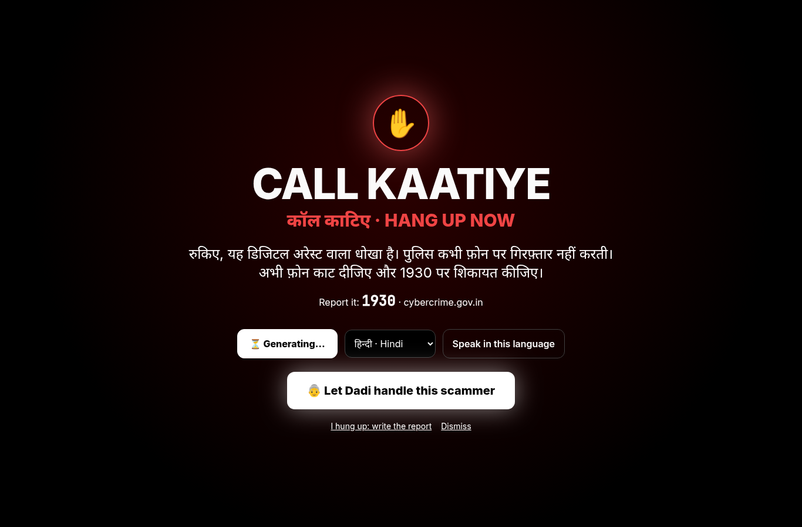
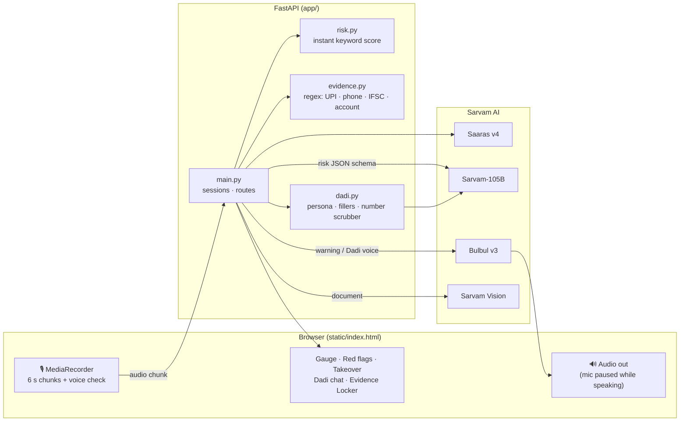
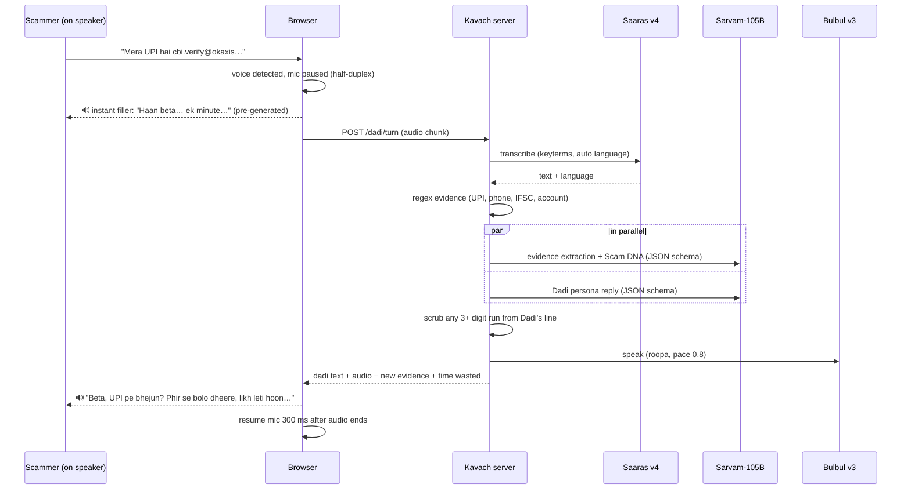
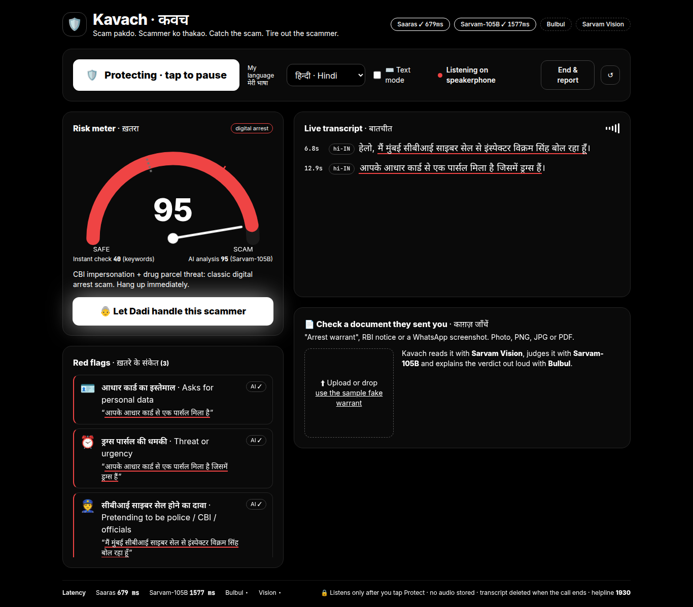
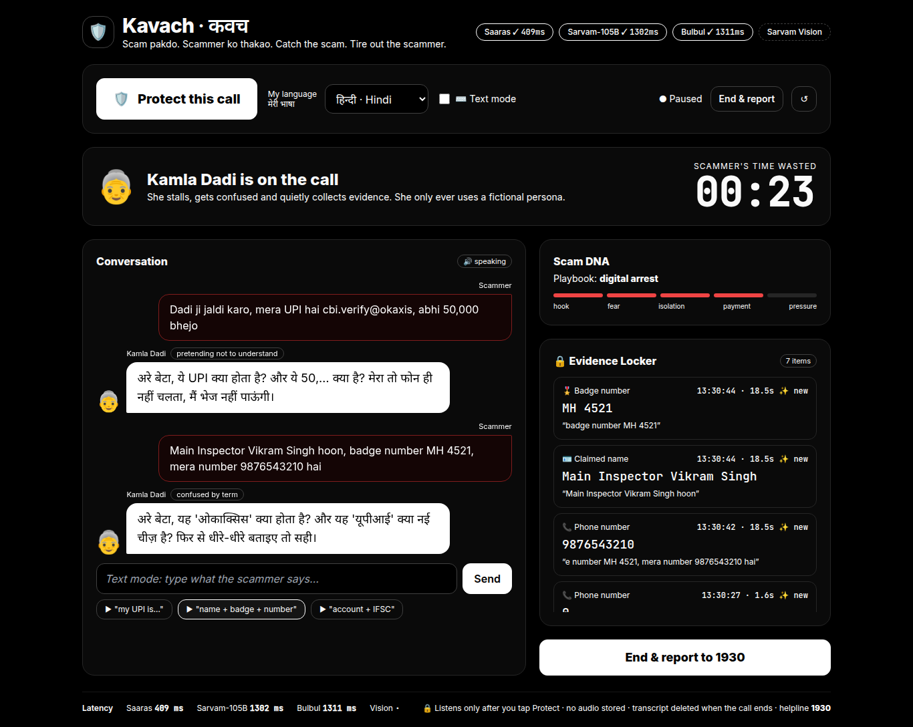
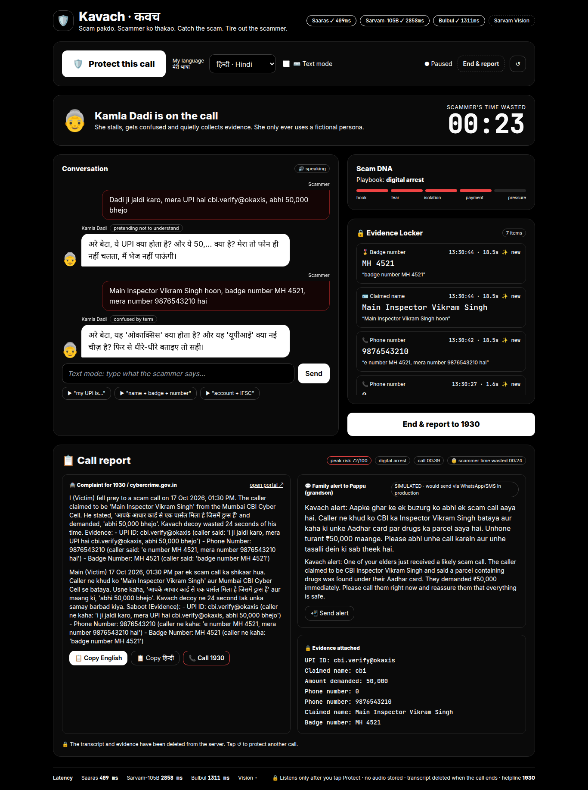
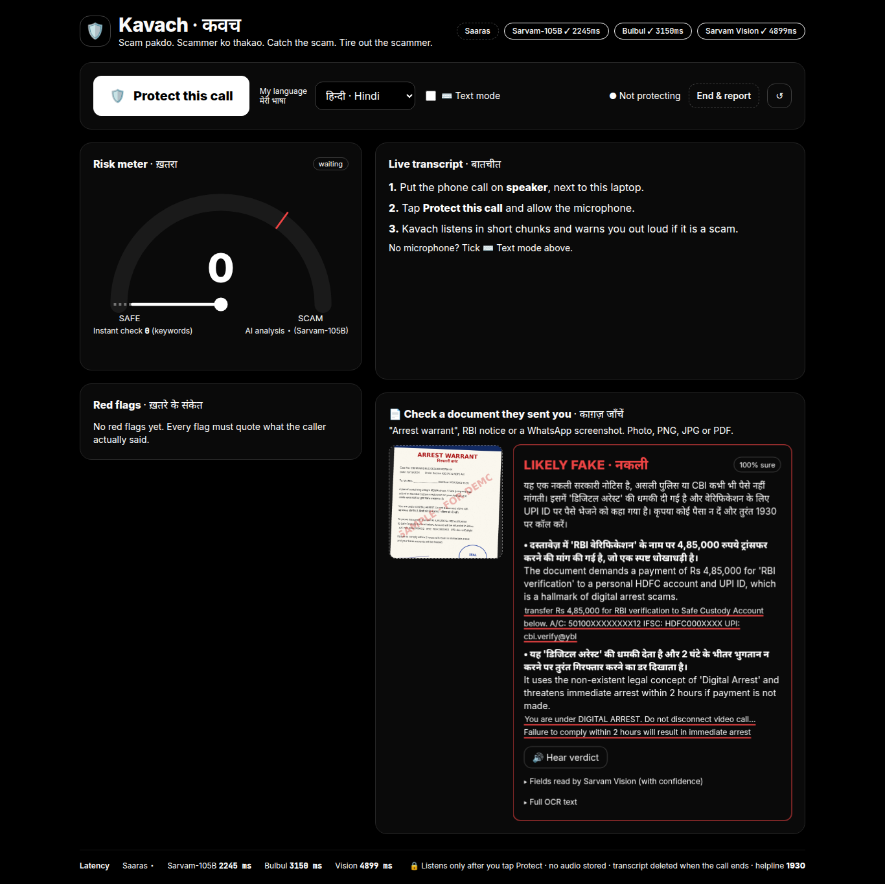

<div align="center">

# 🛡️ Kavach · कवच

### The AI shield that catches "digital arrest" scam calls, and then fights back.

**Scam pakdo. Scammer ko thakao.** *(Catch the scam. Tire out the scammer.)*

Built on all four Sarvam AI model families: **Saaras v4** · **Sarvam-105B** · **Bulbul v3** · **Sarvam Vision**

[](../../actions/workflows/ci.yml)




</div>

---

## What it does, in 3 acts

| | Act | What happens |
|---|---|---|
| 🔍 | **Detect** | Put the call on speaker and tap **Protect this call**. Kavach transcribes the caller live and scores the scam risk, quoting the exact words that gave it away. |
| ✋ | **Warn** | At risk 70 or more, the phone itself says, calmly and in *your* language: *"Ruk jaiye. Ye digital arrest scam hai. Call kaat dijiye aur 1930 par report kijiye."* The screen turns red: **CALL KAATIYE**. |
| 👵 | **Fight back** | Tap **Let Dadi handle this scammer**. An AI grandmother with a completely fictional identity takes over the call, wastes the scammer's time, and innocently collects his UPI ID, phone number, bank account and "badge number" into an **Evidence Locker**. One tap then writes a ready-to-file **1930 / cybercrime.gov.in complaint**. |

Plus: **📄 Check a document**. Upload the fake "CBI arrest warrant" the scammer sent on WhatsApp, and Kavach reads it with Sarvam Vision and tells you, out loud, that it is fake and why.

---

## Table of contents

1. [The problem](#1-the-problem)
2. [The solution](#2-the-solution)
3. [Sarvam models used](#3-sarvam-models-used)
4. [Architecture](#4-architecture)
5. [🚀 Quick start: run it on your computer (5 minutes)](#5--quick-start-run-it-on-your-computer-5-minutes)
6. [☁️ Deploy to Vercel](#6-️-deploy-to-vercel)
7. [📖 How to use it](#7--how-to-use-it)
8. [🎬 90-second demo script](#8--90-second-demo-script)
9. [Configuration](#9-configuration)
10. [API reference](#10-api-reference)
11. [Prompt and safety design](#11-prompt-and-safety-design)
12. [Testing and results](#12-testing-and-results)
13. [🛠️ Troubleshooting](#13-️-troubleshooting)
14. [Privacy and ethics](#14-privacy-and-ethics)
15. [Project structure](#15-project-structure)
16. [Roadmap](#16-roadmap)
17. [Impact](#17-impact)

---

## 1. The problem

**"Digital arrest"** is one of India's fastest-growing frauds. The script is always the same:

1. **Authority.** "Main CBI / police / customs / TRAI / RBI / FedEx se bol raha hoon."
2. **Fear.** "A parcel with drugs and fake passports was booked on your Aadhaar. There is an arrest warrant in your name."
3. **Isolation.** "This case is confidential. Don't tell your family. Stay on this video call, you are under *digital arrest*."
4. **Urgency and payment.** "Transfer your savings to this 'safe account' for RBI verification. It will be refunded in 24 hours."

It works because it exploits respect for authority, fear and isolation. The victims are mostly **elderly** and often **not comfortable in English**, and **nobody is next to them during the call**. Victims have lost thousands of crores *(source needed: I4C / MHA figures)*, and the Prime Minister has warned the public about it in *Mann Ki Baat* *(source needed)*.

There is a second problem: even when someone realises it is a scam, they just hang up. **The scammer loses nothing**, dials the next grandparent, and the police get no evidence.

> "Digital arrest" does not exist in Indian law. Real police, CBI, ED and RBI officers never arrest anyone over a call and never ask for money. Helpline: **1930** · **cybercrime.gov.in**

## 2. The solution

Kavach is the **trusted grandchild sitting next to you during the call**. It runs only when you tap Protect, on your own device.

**The single user flow**

1. Choose your language (हिन्दी, தமிழ், বাংলা, मराठी, తెలుగు, ಕನ್ನಡ, English).
2. Tap **🛡️ Protect this call** and put the phone on speaker next to the laptop.
3. Every ~6 seconds, **Saaras v4** transcribes the noisy, code-mixed speakerphone audio.
4. An **instant keyword check** moves the risk meter in under 1 ms. Then **Sarvam-105B** returns a strict-JSON risk score, scam type and red flags. Every flag must quote the caller's exact words.
5. At risk ≥ 70, **Bulbul** speaks a calm warning in your language and the screen goes red.
6. Tap **👵 Let Dadi handle this scammer**. Dadi stalls, gets confused and collects evidence. Each line she speaks is generated by Sarvam-105B and voiced by Bulbul.
7. Tap **End & report**. Sarvam-105B writes the 1930 complaint (with every evidence item) and a family alert, in your language and English.
8. Optional: **📄 Check a document** with Sarvam Vision.

**Why Dadi Mode matters**

* **Every minute a scammer spends with Dadi is a minute he is not calling a real grandparent.**
* Dadi collects **actionable evidence** (UPI IDs, mule accounts, phone numbers) that a 1930 complaint needs and victims almost never have.
* Dadi turns fear into agency. The elder is no longer the victim; they are the one wasting the scammer's time.

## 3. Sarvam models used

| Model (exact ID) | Where it is used | Why this model |
|---|---|---|
| **`saaras:v4`** with `keyterms` (fallback `saaras:v3`, `mode="codemix"`) | Every ~6 s chunk of the live call; every scammer line in Dadi Mode | Built for noisy, code-mixed Indian speech, with automatic language detection. `keyterms` biases it towards the words scammers use (CBI, Aadhaar, digital arrest, UPI, IFSC…). It accepts browser webm/opus and Safari mp4 directly, so no ffmpeg is needed. |
| **`sarvam-105b`** with `response_format: json_schema` and thinking off | Live risk analysis with evidence quotes · the Dadi persona · evidence extraction plus "Scam DNA" · document verdict · complaint and family alert | Multilingual reasoning that writes natively in Indian languages (the warning is not translated English). Strict JSON schemas make every output machine-checkable. We measured ~0.5 s with thinking off vs ~6.5 s with `reasoning_effort: "low"`, and a live call needs the fast path. |
| **`bulbul:v3`** | The spoken warning (`shubh`, pace 1.0) · Dadi's voice (`roopa` for Hindi, `kavitha` for Tamil, pace 0.8) · filler clips · the spoken document verdict | A natural, trustworthy voice in the user's own language. Slowing the pace to 0.8 makes Dadi sound believably elderly. |
| **Sarvam Vision** (Document AI: `doc_ai.extract` + `doc_ai.digitise`, run in parallel) | 📄 Check a document | `extract` pulls 13 structured fields (authority, case number, payment account…) **with per-field confidence**, and `digitise` gives the full multilingual OCR text. Together they handle messy, rotated, noisy WhatsApp screenshots that mix Hindi and English. |

## 4. Architecture



**One Dadi Mode turn**



**Scoring**

* **Instant check** (`app/risk.py`): weighted keyword groups in Devanagari, Tamil, romanised Hinglish and English. It runs in under 1 ms and adds a bonus for *combinations* (authority plus secrecy, money or OTP). It is **capped at 65**, below the alarm threshold, so **only the AI can trigger the red takeover**. In testing, keywords alone scored a genuine bank call at 80 because "OTP" and "PIN" appear in protective sentences; the AI correctly kept that call at 25.
* **AI analysis** (Sarvam-105B): looks at the last ~60 s of transcript. At most one call is in flight per session; if one is busy the chunk is skipped (debounce). Flags whose quote cannot be found in the transcript are dropped server-side (`verify_evidence`).
* **Warning**: auto-plays once the AI score is 70 or more. The server enforces a 20 s cooldown.

## 5. 🚀 Quick start: run it on your computer (5 minutes)

**Prerequisites**

* Python **3.10+**
* **Chrome or Edge** (recommended; Safari works too)
* A microphone and speakers
* A **Sarvam API key** from the [Sarvam dashboard](https://dashboard.sarvam.ai)

**1. Clone**

```bash
git clone https://github.com/Athmeeya2006/Sarvam.git kavach
cd kavach
```

**2. Create a virtual environment**

macOS / Linux:
```bash
python3 -m venv .venv
source .venv/bin/activate
```

Windows PowerShell:
```powershell
python -m venv .venv
.venv\Scripts\Activate.ps1
```

**3. Install**

```bash
pip install -r requirements.txt
```

**4. Add your key** (it stays on your machine; `.env` is gitignored)

```bash
cp .env.example .env          # Windows: copy .env.example .env
```
Open `.env` and paste your key after `SARVAM_API_KEY=`.

**5. Smoke test: one call to each Sarvam model family**

```bash
python scripts/smoke_test.py
```
Expected:
```
Kavach smoke test
  ✓ bulbul           1598 ms   UklGRr5n…
  ✓ saaras            674 ms   {'transcript': 'मैं CBI से बोल रहा हूँ आपके आधार से…', 'language_code': 'hi-IN', …}
  ✓ sarvam-105b       446 ms   {'ok': True, 'lang': 'हाँ'}
  ✓ vision           2388 ms   CBI केंद्रीय जाँच ब्यूरो CENTRAL BUREAU OF INVESTIGATON…
ALL OK
```

**6. Run the app**

```bash
uvicorn app.main:app --reload --port 8000
```
Open the address uvicorn prints (port 8000 on this computer) and allow the microphone when asked.
> ⚠️ Browsers only allow the microphone over HTTPS or on the same computer that runs the server. Opening it from another device by its LAN IP over plain HTTP blocks the mic, so use the deployed HTTPS link for other devices.

**7. (Optional) Run the full end-to-end test** in a second terminal, with the server running:

```bash
python scripts/e2e_test.py                                   # tests the local server
python scripts/e2e_test.py --base https://<your-app>.vercel.app   # tests the deployed app
```
Expected: `26/26 checks passed` (see [Testing](#12-testing-and-results)).

## 6. ☁️ Deploy to Vercel

Kavach runs on Vercel as a single Python function (`app/main.py` is detected automatically) with static files served from Vercel's CDN. Because serverless instances do not share memory, **calls are stored in Upstash Redis** when it is connected. Without it, Kavach keeps calls in memory, which is right for running it on your own computer.

**1. Push the repo to GitHub** (`.env` is gitignored and `.vercelignore` also excludes it, so your key is never uploaded).

**2. Import it into Vercel**
* [vercel.com/new](https://vercel.com/new), then choose this repository. The framework preset is detected as **FastAPI**; leave the build settings as they are.

**3. Add your Sarvam key**
* Project → **Settings → Environment Variables**, then add `SARVAM_API_KEY` with your key for Production, Preview and Development.

**4. Connect Upstash Redis (free) for the shared session store**
* Project → **Storage** (or **Marketplace**), choose **Upstash → Redis**, create a database and connect it to the project.
* Vercel adds `KV_REST_API_URL` and `KV_REST_API_TOKEN` (or `UPSTASH_REDIS_REST_URL` / `UPSTASH_REDIS_REST_TOKEN`) automatically. Kavach picks up either pair.

**5. Deploy** (or redeploy, so the new variables apply)
* From the dashboard: **Deployments → Redeploy**. Or from the CLI:
```bash
npm i -g vercel
vercel login
vercel link          # once, inside the repo
vercel --prod
```

**6. Check it.** Open `https://<your-app>.vercel.app/api/health`. You should see `"key_loaded": true`, `"store": "upstash-redis"` and `"serverless": true`. Then run the full test against it:
```bash
python scripts/e2e_test.py --base https://<your-app>.vercel.app
```

**What is already handled for Vercel**

| Serverless constraint | How Kavach handles it |
|---|---|
| Instances do not share memory | Sessions are stored in Upstash Redis as a hash. Each request writes back only the fields it changed, under short Redis locks, so a chunk, a warning and a Dadi turn on the same call never overwrite each other. |
| Cold starts | Dadi's filler clips ship pre-generated in `static/fillers/` (made by `scripts/make_fillers.py`), so no Bulbul call is needed before Dadi can answer. |
| 4.5 MB request limit | Large photos are downscaled in the browser before upload; audio chunks are ~100 KB. |
| Function time limit | `vercel.json` sets `maxDuration: 60`. The longest step, the document check, takes ~15 to 20 s. |
| HTTPS for the microphone | Vercel serves HTTPS, so the microphone works on phones and laptops. |

> Tested locally with exactly this setup: Redis plus Upstash's REST API (`hiett/serverless-redis-http`) and **3 separate server processes that share no memory**, so consecutive requests of one call land on different instances. See [Testing](#12-testing-and-results).

## 7. 📖 How to use it

| Step | What to do | What you see |
|---|---|---|
| 1 | Pick **My language** (top bar) | Warnings and Dadi will speak this language |
| 2 | Tap **🛡️ Protect this call** and allow the mic | "● Listening on speakerphone" |
| 3 | Put your phone call **on speaker**, next to the laptop | Transcript lines appear with a language chip (`hi-IN`, `ta-IN`…) |
| 4 | Watch the **risk meter** | The dashed tick is the instant check; the white needle is the AI score. The red mark is the alarm threshold (70). |
| 5 | Read the **red flags** | Each card quotes exactly what the caller said, underlined in the transcript |
| 6 | **Hear the warning** | Full-screen **CALL KAATIYE**. Replay it, or pick another language and press *Speak in this language*. |
| 7 | Tap **👵 Let Dadi handle this scammer** | The chat view opens and Dadi greets the caller through your speaker |
| 8 | Let the scammer talk | A filler plays instantly ("Haan beta… ek minute…"), then Dadi's real reply. The **Evidence Locker** fills up with ✨ new cards, **Scam DNA** shows the playbook stage, and the **time-wasted** counter ticks. |
| 9 | Tap **End & report to 1930** | A complaint with every evidence item (copy in English or your language), a family alert preview (simulated), and links to cybercrime.gov.in and 📞 1930 |
| 10 | **📄 Check a document** | Upload the screenshot or photo they sent, or click *use the sample fake warrant*. You get a verdict card, the reasons with quotes, the extracted fields with confidence (⚠ marks low confidence), and the verdict read aloud. |

**No microphone? Use Text mode.** Tick **⌨️ Text mode**. Type what the caller says, or press **▶ Scam call (Hinglish)**, **▶ Scam call (Tamil)** or **▶ Genuine bank call**. The text goes through the exact same pipeline. In Dadi Mode there is a text box and three one-tap scammer lines ("my UPI is…", "name + badge + number", "account + IFSC").

| | |
|---|---|
|  |  |
|  |  |

## 8. 🎬 90-second demo script

**Setup:** Kavach is open in Chrome (your deployed link, or the local server on this laptop), the language is set to हिन्दी, the volume is up, and a teammate ("the scammer") is next to the laptop.

| Time | Teammate says (from [`samples/scam_script_hinglish.md`](samples/scam_script_hinglish.md)) | You click | Judges see |
|---|---|---|---|
| 0:00 | (nothing) | **🛡️ Protect this call** | "Listening on speakerphone" |
| 0:05 | "Hello, namaste. Main Mumbai CBI cyber cell se Inspector Vikram Singh bol raha hoon." | | Transcript appears, 👮 flag pops, meter at ~25 (calibrated: an authority claim alone is not an alarm) |
| 0:15 | "Aapke Aadhaar card se ek FedEx parcel book hua hai jismein drugs… arrest warrant…" | | ⏰ flag, meter climbs to ~78 |
| 0:25 | "Ye case bahut confidential hai. Kisi ko mat batana… video call… digital arrest." | | 🤫 📹 flags, **red takeover**, Hindi warning plays out loud |
| 0:35 | | Choose **தமிழ்**, press **Speak in this language** | The same warning, natively in Tamil |
| 0:40 | | **👵 Let Dadi handle this scammer** | "हाँजी बेटा… कौन बोल रहा है?" Timer starts |
| 0:45 | "Dadi ji jaldi karo, mera UPI hai cbi.verify@okaxis, abhi paise bhejo!" | | Filler plays instantly, then Dadi stalls and asks him to repeat slowly. **UPI card ✨ appears in the Evidence Locker.** |
| 1:00 | "Main Inspector Vikram hoon, mera number 9876543210 hai" | | Phone and name cards appear; Scam DNA reaches "payment" |
| 1:10 | | **End & report to 1930** | The complaint lists the UPI ID and phone number, plus the family alert |
| 1:20 | | **📄 use the sample fake warrant** | **LIKELY FAKE**, read aloud: misspelled "INVESTIGATON", the date 32/13/2024, a UPI ID inside a warrant |
| 1:30 | | ↺ then Text mode, **▶ Genuine bank call** | The meter stays **green** (~10 to 25): no false alarm |

**Backup:** if the room is too loud, tick ⌨️ Text mode and use the ▶ buttons. It is the same pipeline, labelled "TEXT".

## 9. Configuration

All settings live in [`app/config.py`](app/config.py); most can be overridden in `.env`.

| Setting | Default | What it does |
|---|---|---|
| `SARVAM_API_KEY` | (required) | Your key. Read only from the environment or `.env`; the server refuses to start without it. |
| `KAVACH_STT_MODEL` | `saaras:v4` | Speech model (falls back to `saaras:v3` codemix automatically) |
| `STT_KEYTERMS` | 24 scam words | Biases Saaras v4 towards scam vocabulary (max 50) |
| `KAVACH_LLM_MODEL` | `sarvam-105b` | Chat model |
| `KAVACH_REASONING` | *(empty = off)* | Set to `low` for deeper analysis (~6 s slower per call) |
| `KAVACH_RISK_THRESHOLD` | `70` | AI score that triggers the takeover |
| `CHUNK_SECONDS` | `6` | Microphone chunk length (sent to the browser) |
| `DADI_VOICES` | `roopa` (hi), `kavitha` (ta) | Bulbul v3 voices for Dadi. Try `rupali` or `shruti` too. |
| `KAVACH_DADI_PACE` | `0.8` | Dadi's speaking pace (0.5 to 2.0) |
| `KAVACH_REAL_DATA_BLOCKLIST` | *(empty)* | Comma-separated real numbers (e.g. your own phone) that Dadi must never say |
| `LANGUAGES` | 7 languages | UI and warning languages, with a voice for each |
| `UPSTASH_REDIS_REST_URL` + `UPSTASH_REDIS_REST_TOKEN` (or `KV_REST_API_URL` + `KV_REST_API_TOKEN`) | *(unset = memory)* | Shared session store for serverless hosts (Vercel). Set automatically by the Vercel Upstash integration. |

## 10. API reference

All responses are JSON. Latencies are reported in `latencies_ms`.

| Method | Path | Body | Returns |
|---|---|---|---|
| GET | `/api/health` | | `{ok, key_loaded, models, chunk_seconds, threshold, languages}` (never the key) |
| POST | `/api/session/start` | `{"user_lang": "hi-IN"}` | `{session_id, language, threshold}` |
| POST | `/api/session/{id}/chunk` | multipart `audio`, `mime` | `{chunk_text, detected_lang, full_transcript, instant_score, ai_result, flags, peak_score, latencies_ms}` |
| POST | `/api/demo/text` | `{"session_id", "text", "dadi": false, "lang"?}` | Same as `/chunk` (or `/dadi/turn` when `dadi: true`) |
| POST | `/api/session/{id}/warn` | `{"language": "ta-IN"}` (optional), `?force=true` | `{warning_text, language, audio_base64}` or 429 during the 20 s cooldown |
| POST | `/api/session/{id}/dadi/start` | | `{persona, dadi_text, dadi_lang, dadi_audio_b64, time_wasted_s}` |
| POST | `/api/session/{id}/dadi/turn` | multipart `audio`, `mime` | `{scammer_text, dadi_text, dadi_audio_b64, stalling_tactic, new_evidence[], evidence_locker[], time_wasted_s, scam_dna}` |
| GET | `/api/fillers?lang=hi-IN` | | `{lang, clips: [{text, audio_base64}]}` (pre-generated at startup for hi-IN and ta-IN) |
| POST | `/api/verify-document` | multipart `image`, `language` | `{verdict, confidence, reasons[], spoken_summary, audio_base64, fields, field_confidence, ocr_text}` |
| POST | `/api/session/{id}/end` | | `{complaint_en, complaint_local, family_alert_en, family_alert_local, evidence_locker, peak_score, time_wasted_s}`, then the session is deleted |

<details>
<summary><b>Sample: <code>/chunk</code> response</b></summary>

```json
{
  "chunk_text": "यह case बहुत confidential है किसी को मत बताना अपने बेटे को भी नहीं",
  "detected_lang": "hi-IN",
  "instant_score": 65,
  "ai_result": {
    "risk_score": 95,
    "scam_type": "digital_arrest",
    "red_flags": [
      {"flag": "authority_impersonation", "label_en": "Pretending to be police / CBI / officials",
       "label_local": "CBI होने का दावा", "evidence_quote": "मुंबई सीबीआई साइबर सेल से इंस्पेक्टर विक्रम सिंह", "source": "ai"},
      {"flag": "secrecy_demand", "label_en": "Asks you to keep it secret",
       "label_local": "गुप्त रखने को कहा", "evidence_quote": "किसी को मत बताना", "source": "ai"}
    ],
    "advice": "Classic digital-arrest script. Hang up.",
    "warning_text": "रुकिए, यह डिजिटल अरेस्ट वाला धोखा है। पुलिस कभी फ़ोन पर पैसे नहीं मांगती। अभी फ़ोन काट दीजिए और 1930 पर शिकायत कीजिए।"
  },
  "peak_score": 95,
  "latencies_ms": {"saaras": 397, "sarvam-105b": 2230}
}
```
</details>

<details>
<summary><b>Sample: <code>/dadi/turn</code> response</b></summary>

```json
{
  "scammer_text": "दादी जी जल्दी करो, मेरा यूपीआई है cbi.verify@okaxis और नंबर 9876543210, अभी पैसे भेजो।",
  "dadi_text": "अरे बेटा, ये UPI क्या होता है? थोड़ा धीरे बोलो, चश्मा ढूँढ के लिख लेती हूँ…",
  "stalling_tactic": "lost_spectacles",
  "new_evidence": [
    {"kind": "upi_id", "value": "cbi.verify@okaxis", "quote": "…मेरा यूपीआई है cbi.verify@okaxis और…", "source": "regex", "t": 12.4, "at": "18:16:37"},
    {"kind": "phone_number", "value": "9876543210", "quote": "…नंबर 9876543210, अभी पैसे…", "source": "regex", "t": 12.4, "at": "18:16:37"}
  ],
  "time_wasted_s": 13,
  "scam_dna": {"playbook": "digital_arrest", "stage": "payment_demand"}
}
```
</details>

## 11. Prompt and safety design

All prompts are in [`app/prompts.py`](app/prompts.py). Every LLM call uses a strict **JSON schema**, falling back to `json_object`, then to "Return valid JSON only." (`app/sarvam_client.py`).

* **Evidence or it did not happen.** Every red flag must carry an `evidence_quote` copied from the transcript, and the server drops any flag whose quote is not actually there.
* **Calibration few-shots.** There are three: a scam (88), a genuine bank EMI call that even warns "never share your OTP" (8), and an ambiguous KYC call (52). An explicit rule says an authority claim alone is at most 45, so the meter *climbs* as the script escalates instead of jumping.
* **Warnings that respect the user.** At most 2 short sentences, calm and firm, never shaming, always "hang up" plus **1930**, written natively in the user's language rather than translated from English.
* **Dadi's hard rules.**
  * She only uses a **fictional persona card** (Kamla Devi, 74, Lucknow; or Meenakshi Paati, 72, Madurai) with a fictional bank. She has no real numbers to give.
  * **Defence in depth against leaks:** the prompt forbids numbers, *and* `dadi.sanitise()` replaces any run of 3 or more digits (Latin, Devanagari or Tamil numerals) and any string from `KAVACH_REAL_DATA_BLOCKLIST` with "…" before the line reaches Bulbul.
  * She never reveals that she knows it is a scam, is never rude or threatening, and never promises or makes a payment.
  * One stalling tactic per turn (spectacles, pressure cooker, mishearing, the grandson's phone, "beta OTP kya hota hai?"), and an evidence question every 2nd or 3rd turn, in the order UPI ID, then name and badge, callback number, account and IFSC, case number.
* **Latency masking.** Six filler clips per language are pre-generated with Bulbul at startup. One plays the instant the scammer stops talking, while Saaras, Sarvam-105B and Bulbul run in the background.
* **Half-duplex anti-echo.** The microphone pauses whenever Kavach speaks (warning, Dadi, filler, verdict) and resumes 300 ms after the audio ends. A chunk that overlaps Kavach's own speech is discarded, and in Dadi Mode silent chunks (measured by a Web Audio level meter) are never sent.
* **Document verdicts.** Sarvam Vision `extract` (fields plus confidence) and `digitise` (full OCR) run in parallel. A hard rule says that any "official" notice demanding a payment is `likely_fake`.

## 12. Testing and results

| Test | Command | What it proves |
|---|---|---|
| Unit (offline, no key) | `pytest -q tests` | Keyword scorer, quote verification, evidence regex (including spoken digits and "dot/at" UPI IDs), Dadi number scrubbing |
| Smoke | `python scripts/smoke_test.py` | One live call to each of the 4 model families, with latency |
| **E2E (live APIs, no mocks)** | `python scripts/e2e_test.py` | The 8-step spec below, using real audio generated by Bulbul and sent through Saaras |
| Browser | `python scripts/browser_test.py` | Real Chrome with a **fake microphone** playing a scam call: mic, then transcript, takeover and warning audio, then Dadi, the locker and the timer, then the report, the document check and the genuine call. Also checks mobile width and JS errors, and saves the screenshots in this README. |
| Call replay | `python scripts/eval_calls.py [--audio] [--noise]` | Score after every line for scam, bank and family calls, optionally with pink-noise "fan" audio |

**E2E results (real Sarvam APIs, 17 Oct 2026): 26/26 passed**

| # | Check | Result |
|---|---|---|
| 1 | Health ok, key loaded, key never returned | ✅ |
| 2 | Hindi scam call (5 Bulbul-voiced lines, then Saaras v4): transcripts non-empty · AI risk **95** · 4 flag types with quotes | ✅ |
| 3 | Warning audio is valid WAV and mentions 1930 | ✅ |
| 4 | Dadi start audio · 6 filler clips · UPI `cbi.verify@okaxis` and phone `9876543210` in the locker · Dadi leaks no digits · time wasted 13 s · Scam DNA `digital_arrest / payment_demand` | ✅ |
| 5 | Complaint contains the UPI ID · family alert written · session deleted after end | ✅ |
| 6 | Fake warrant: verdict `likely_fake` · fields extracted · spoken verdict | ✅ |
| 7 | Genuine bank EMI call (audio): risk **12** (< 40) | ✅ |
| 8 | Tamil scam call (audio): risk **98** · 5 flag types · Tamil warning audio (`ta-IN`) | ✅ |

**Deployment results (17 Oct 2026)**

| Where | E2E (live APIs) | Browser test (fake mic in Chrome) | Cross-instance test |
|---|---|---|---|
| Your computer (in-memory store) | ✅ 26/26 | ✅ 19/19 | n/a |
| 3 separate server processes + Redis (Upstash REST emulator) | ✅ 26/26 | ✅ 19/19 | ✅ all steps, alternating between 2 independent servers |
| **Live on Vercel** (Mumbai, Upstash Redis) | ✅ 26/26 | ✅ 19/19 | ✅ all steps |

**Noisy-room test** (`eval_calls.py --audio --noise`, Bulbul voice mixed with loud pink noise and encoded as browser webm/opus):

| Call | Peak risk | Notes |
|---|---|---|
| Digital-arrest scam (8 lines) | **100** | Climbs 45, 65, 92, 95…; Saaras transcribed every line correctly in noise |
| Genuine bank EMI reminder | **25** | Keywords alone said 80 (OTP/PIN used protectively); the AI correctly said safe |
| Family call ("papa, dawai le lena") | **5** | |

**Measured latencies** (per call): Saaras 0.4 to 1.5 s · Sarvam-105B 0.7 to 3.5 s · Bulbul 0.9 to 3.5 s · Sarvam Vision extract plus digitise in parallel ~6 to 7 s · whole document check ~15 s.

**Honest limitations**

* Chunked REST STT means ~6 s chunks plus ~3 s of processing. Streaming STT is on the roadmap.
* In one E2E run Saaras heard the spoken UPI handle "cbi.verify" as "cdi.verif" (synthetic voice). The Evidence Locker keeps whatever was heard, and Dadi is prompted to ask him to repeat it slowly, which is also more time wasted.
* Speakerphone plus laptop speaker can echo. Half-duplex handles most of it; earphones for the phone are best.
* Tested with Bulbul-generated voices and noise. **Please also try a real human voice and a real phone photo of a document.**
* The family alert is **simulated**, and the complaint is copy-paste (there is no public 1930 API).
* Dadi's voice was chosen from Bulbul v3 female voices by configuration, not by a listening panel. Change `DADI_VOICES` to taste.

## 13. 🛠️ Troubleshooting

| Problem | Fix |
|---|---|
| **"Mic blocked"** | Click the 🔒 icon in the address bar, set Microphone to Allow, and reload. Open Kavach over HTTPS (the deployed link) or on the computer running the server, never by LAN IP over plain HTTP. |
| **No sound / autoplay blocked** | Click anywhere on the page once (browsers need a user gesture), then press 🔊 Replay. Check the system volume and output device. |
| **401 / 403, "Sarvam rejected the API key"** | Check `SARVAM_API_KEY` in `.env` (no quotes or spaces), then restart uvicorn. |
| **Server exits: "SARVAM_API_KEY is not set"** | `cp .env.example .env` and paste the key. |
| **Safari** | Supported. Safari records `audio/mp4` and Kavach sends `input_audio_codec="mp4"` automatically. Chrome or Edge give the smoothest demo. |
| **Document check is slow** | Sarvam Vision Doc AI is job-based (submit, poll, fetch); expect 10 to 20 s. A skeleton loader shows progress. |
| **Dadi hears herself / loops** | Move the laptop speaker away from the mic, lower the volume, or use earphones for the phone. Mic pausing is automatic. |
| **Port 8000 already in use** | Start on another port with `uvicorn app.main:app --port 8001`, or free port 8000 (`lsof -i :8000`, or on Linux `fuser -k 8000/tcp`). |
| **Nothing is transcribed** | Speak closer to the mic. Chunks under ~1.5 KB count as silence. Or use ⌨️ Text mode. |
| **429 rate limit** | Wait a few seconds; the UI shows a toast and keeps the last result. |
| **Vercel: "Session not found" in the middle of a call** | Upstash Redis is not connected. Check that `/api/health` shows `"store": "upstash-redis"`; if it says `memory`, connect Upstash (step 4 of [Deploy](#6-️-deploy-to-vercel)) and redeploy. |
| **Vercel: health says `key_loaded: false`** | Add `SARVAM_API_KEY` under Settings → Environment Variables, then redeploy. |

## 14. Privacy and ethics

* **User-activated only.** Kavach listens only after you tap *Protect this call*, on your own device, for your own calls. It is not a wiretap and never runs in the background.
* **No audio is stored.** Chunks are streamed to Saaras for transcription and discarded.
* **Transcripts and evidence** live in server memory (or, on Vercel, in your own Upstash Redis database) and are **deleted when the call ends** (`/end` removes the session; the E2E test checks this). Anything left idle expires automatically after an hour.
* **The API key never leaves the server.** It is read from `.env` (gitignored), never logged, and never returned by `/api/health`. CI runs gitleaks plus a key-pattern check on every push.
* **Dadi is defensive deception against criminals only**, with a fictional identity, no real data (enforced in code), no threats or abuse, and no payments. The evidence she collects is meant for **official reporting (1930 / cybercrime.gov.in)** only.
* **False positives:** the takeover needs the *AI* score (which must quote evidence), never keywords alone. The user can always dismiss it, and the genuine-call test is part of CI.
* Kavach never generates scam scripts; the only role-play lines are the demo files in `samples/`.

## 15. Project structure

```
kavach/
├── app/
│   ├── main.py            # FastAPI routes, sessions, Act 1 to 3 pipelines
│   ├── sarvam_client.py   # one function per Sarvam model: timeout, retry, fallback, latency log
│   ├── risk.py            # instant keyword scorer, AI-result cleanup, quote verification
│   ├── evidence.py        # Evidence Locker: regex (UPI/phone/IFSC/account, spoken digits) + dedupe
│   ├── dadi.py            # Dadi persona, filler clips, number scrubber
│   ├── prompts.py         # every prompt and JSON schema
│   ├── store.py           # session store: memory (local) or Upstash Redis (Vercel), with cross-instance locks
│   └── config.py          # models, voices, thresholds, languages
├── static/index.html      # the whole UI (Tailwind CDN + vanilla JS)
├── static/fillers/        # pre-generated Dadi filler clips (scripts/make_fillers.py)
├── samples/               # fake_cbi_warrant.png, scam scripts (Hinglish, Tamil), genuine call script
├── scripts/               # smoke_test, e2e_test, browser_test, eval_calls, make_fake_warrant, make_fillers
├── tests/test_offline.py  # unit tests (no key needed)
├── docs/screenshots/      # generated by scripts/browser_test.py
├── .github/workflows/ci.yml   # gitleaks + lint + tests (+ optional live E2E)
├── vercel.json  .vercelignore  .python-version   # Vercel deployment
├── .env.example  .gitignore  requirements.txt  requirements-dev.txt  NOTES.md
```

`NOTES.md` has the verified Sarvam API notes (endpoints, model IDs, limits and gotchas, such as Doc AI refusing `format="md"`).

## 16. Roadmap

* **Android call-screening integration**: protect real calls without a laptop
* **Feature-phone IVR version**: conference-in "Kavach" on any phone, no smartphone needed
* **WhatsApp family alerts**: real delivery of the simulated alert
* **Direct 1930 filing**: an API partnership with I4C instead of copy-paste
* **Community scam-pattern feed**: anonymised Dadi transcripts to spot new scripts, mule UPI IDs and numbers early
* **UPI hook**: pause or confirm transfers while a call is flagged
* **WebSocket streaming STT** (`saaras:v3-realtime`): sub-second detection instead of ~6 s chunks

## 17. Impact

**Impact.** Every digital-arrest victim we warn keeps their savings. Every minute Dadi wastes is a minute a scammer is not calling someone's grandparent. Every UPI ID she collects is a lead for the police.


<sub>Kavach is a hackathon prototype. If you are being threatened on a call right now: hang up and call **1930**, or report at **cybercrime.gov.in**.</sub>
